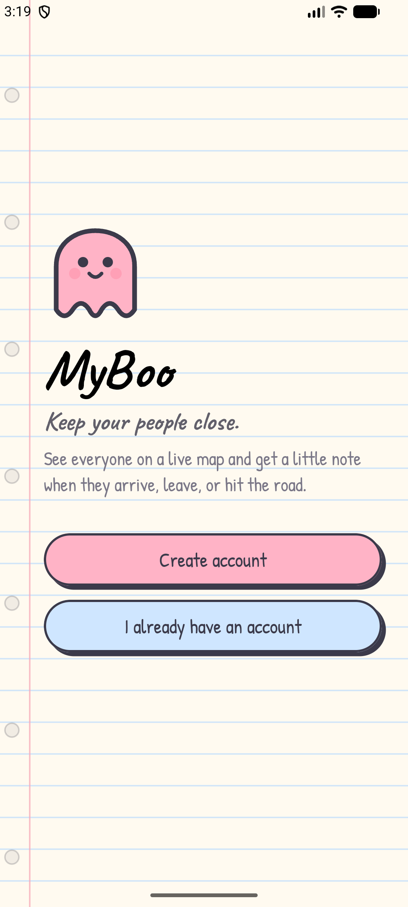
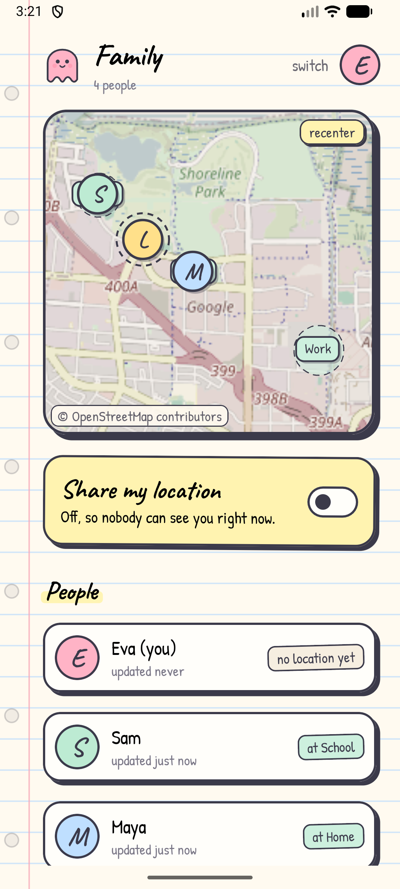
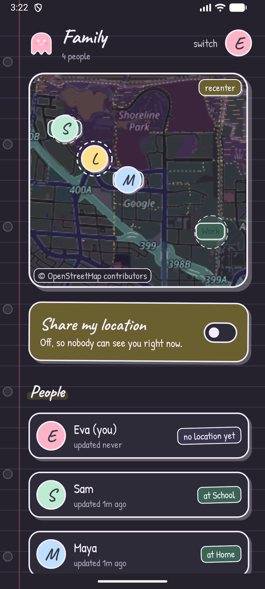
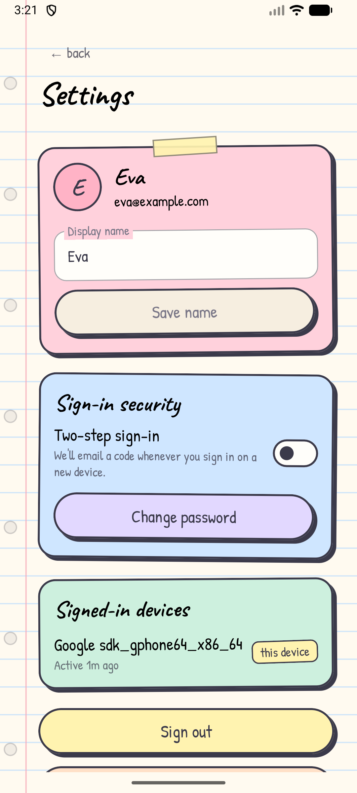

# MyBoo

A cozy, self-hostable location-sharing app in the spirit of Life360. Create a circle, share the invite code, see everyone on a **live map**, and get a push notification when someone **arrives at**, **leaves**, or **starts driving** from a place you care about. Pastel, notebook-themed, with real email accounts and two-step sign-in.

- `android/` — Kotlin + Jetpack Compose app (OpenStreetMap live map, foreground location service, FCM push)
- `backend/` — Cloudflare Worker + D1 (SQLite): accounts, geofence/driving detection, push via FCM, email via Cloudflare Email Service

<p align="center">
  
  
  
  
</p>

## Features

**Map & alerts**
- Live OpenStreetMap view (no API key) tinted to the pastel theme; avatars, dashed geofence circles, driving halo, recenter.
- Arrive / leave alerts: enter at `radius`, leave only past `radius × 1.25` (GPS-jitter hysteresis); fixes with accuracy > 100 m are ignored for transitions.
- "Started driving": speed ≥ 4.5 m/s on 2 consecutive fixes; stops when < 1 m/s.
- The first-ever fix only sets a baseline, so joining doesn't fire fake arrivals.

**Accounts**
- Email + password sign-up with **email verification code**.
- **Two-step sign-in** (optional, email code), enabled per account in Settings.
- Forgot / reset password by emailed code (signs out all devices), change password, edit name.
- Signed-in devices list with per-device sign-out, sign out everywhere, delete account.
- Hardening: PBKDF2-SHA256 password hashing, hashed one-time codes (10 min, 5 attempts, single use, resend cooldown, hourly cap), account lockout after repeated bad passwords, no account enumeration on password reset, revocable 90-day sliding sessions.

**Web**
- **Landing page** at `/`: pastel-notebook marketing page with screenshots (static assets in `backend/public/img`), features, FAQ and a live status dot.
- **Status page** at `/status` (and JSON at `/status.json`): API, database, email, push and map-tile health with 30-day uptime bars. A cron trigger (every 5 min) probes the API, database and OSM tiles; email and push outcomes are recorded when they happen. Data lives in the D1 `checks` table (35-day retention).

**Self-updating**
- Not on a store: the app checks GitHub Releases on launch (at most every 6 h, or manually in Settings), downloads the `.apk` asset in the background, and offers a one-tap "Update now" (system installer; Android 12+ updates without an extra prompt after the first one).
- Cut a release with `scripts/release.sh 1.2.0 "notes"`. It builds an APK signed with `~/.myboo/myboo-release.jks` and publishes `myboo.apk` to a GitHub release. **Back up that keystore:** an update only installs over the same signing key.

## Deployment

The site and API are live at **https://myboo.evaakselrad.com** (`GET /health`), and the app points at it by default.

### Backend

```bash
cd backend
npm install
npx wrangler d1 create myboo          # put database_id in wrangler.jsonc
npm run db:remote                     # apply schema.sql
# Email: the sender domain must be onboarded to Cloudflare Email Sending
npx wrangler email sending enable <your-domain>
#   then set FROM_EMAIL in wrangler.jsonc (e.g. myboo@<your-domain>)
npx wrangler secret put FCM_SERVICE_ACCOUNT    # Firebase service-account JSON (push)
npm run deploy                        # also attaches the custom domain in `routes`
```

Local dev: put `DEV_LOG_CODES=1` in `backend/.dev.vars` (never in production), then `npm run db:local && npm run dev`. One-time codes are printed to the console instead of emailed. Tests: `npm test` (unit) and, with the dev server running, `npm run test:e2e -- http://localhost:8787 <path-to-dev-server-log>` (full account flow).

### Android

1. Create a Firebase project, add an Android app with package `com.myboo.app`, and put its `google-services.json` in `android/app/` (gitignored). Generate a service-account key there for `FCM_SERVICE_ACCOUNT`.
2. Point at your own backend with `myboo.apiUrl=https://your.domain` in `~/.gradle/gradle.properties` (use `http://10.0.2.2:8787` for the emulator + `wrangler dev`).
3. Open `android/` in Android Studio, or run `./gradlew :app:installDebug`.

Map tiles come from the public OpenStreetMap tile server, which is fine for development and small groups; for heavy use switch `TileSourceFactory.MAPNIK` in `LiveMap.kt` to a hosted provider (and keep the attribution).

## API

| Method | Path | Notes |
|---|---|---|
| POST | `/v1/auth/signup` | `{email, name, password}` → `{challenge_id}` (code emailed) |
| POST | `/v1/auth/verify-email` | `{challenge_id, code}` → `{token, user}` |
| POST | `/v1/auth/login` | `{email, password}` → session, or `{challenge_id, step}` if a code is needed |
| POST | `/v1/auth/2fa` | `{challenge_id, code}` → `{token, user}` |
| POST | `/v1/auth/resend` | `{challenge_id}` |
| POST | `/v1/auth/forgot`, `/v1/auth/reset` | `{email}` → `{challenge_id}`; `{challenge_id, code, new_password}` |
| POST | `/v1/auth/logout` | revoke this session |
| GET / PATCH / DELETE | `/v1/me` | profile; `PATCH` name or `twofa_enabled`+`password`; `DELETE {password}` |
| POST | `/v1/me/password` | `{current_password, new_password}` |
| GET / DELETE | `/v1/me/sessions[/:id]` | devices |
| POST | `/v1/me/logout-all` | |
| PUT | `/v1/me/fcm-token` | `{token}` |
| GET / POST | `/v1/me/circles`, `/v1/circles`, `/v1/circles/join` | |
| GET | `/v1/circles/:id` | members (last location, driving, current places) + places |
| POST / DELETE | `/v1/circles/:id/places[/:pid]` | `{name, lat, lng, radius_m}` |
| POST | `/v1/location` | `{lat, lng, speed?, accuracy?, ts?}` |

Everything except `/v1/auth/*` and `/health` needs `Authorization: Bearer <token>`.

## Known limitations / roadmap

- Changing the account email isn't supported yet; privacy policy / terms pages aren't written yet (needed before a store release).
- Only the latest location is stored — no history or trip replay.
- One push token per account (the latest device wins).
- Boot auto-resume of sharing may be blocked by Android 14+ background-start rules for location foreground services; open the app once after reboot.
- No per-person notification preferences or quiet hours.

## Credits

Fonts: [Caveat](https://fonts.google.com/specimen/Caveat) and [Patrick Hand](https://fonts.google.com/specimen/Patrick+Hand), both under the SIL Open Font License 1.1. Map data © OpenStreetMap contributors.
